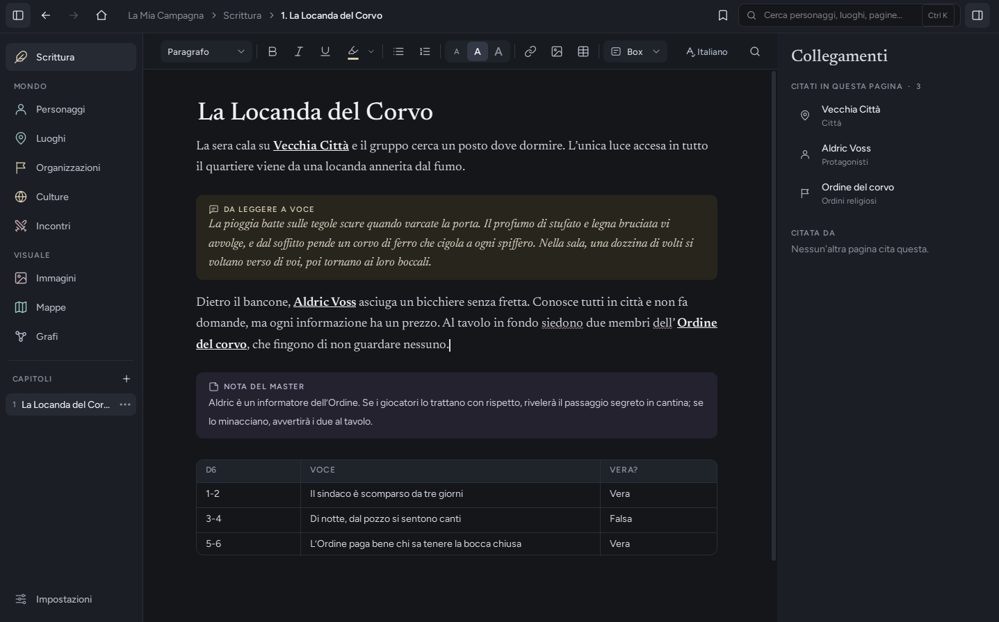
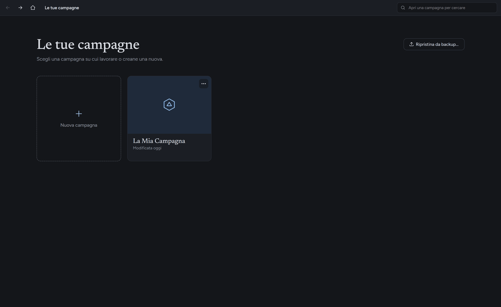
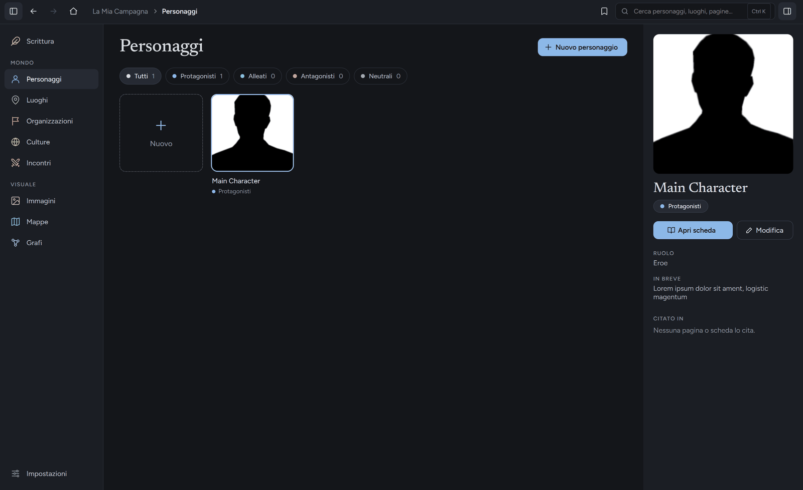
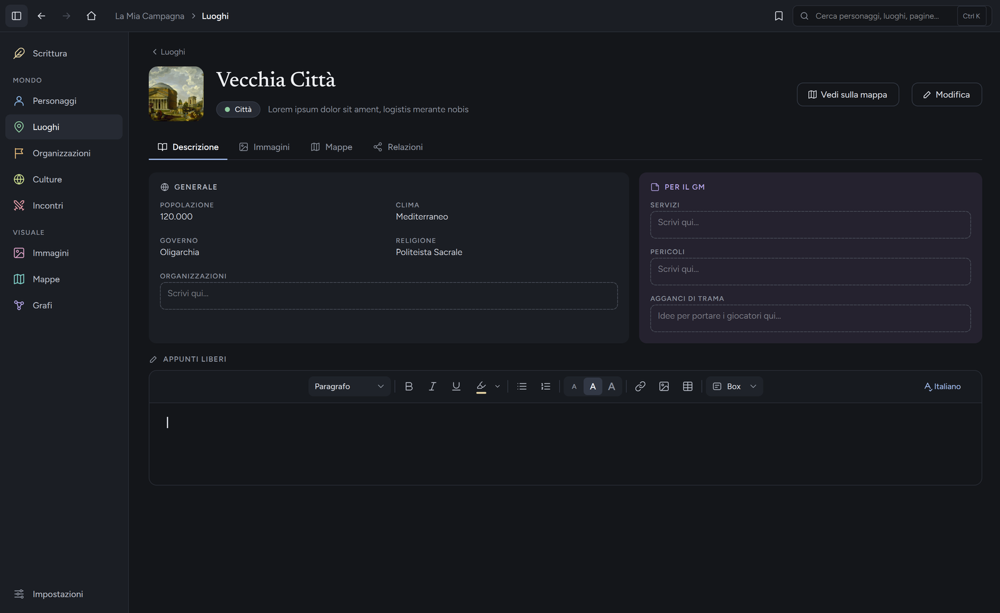
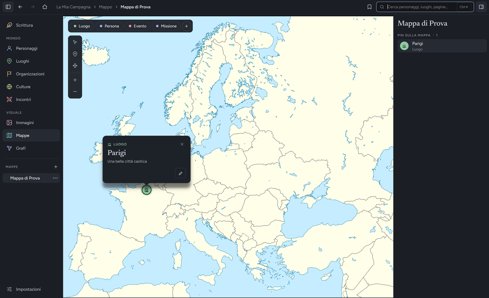
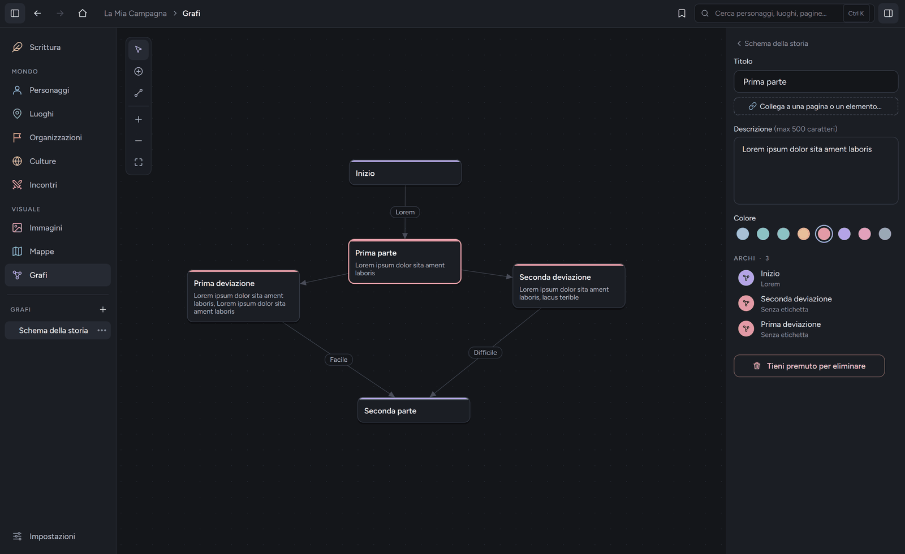
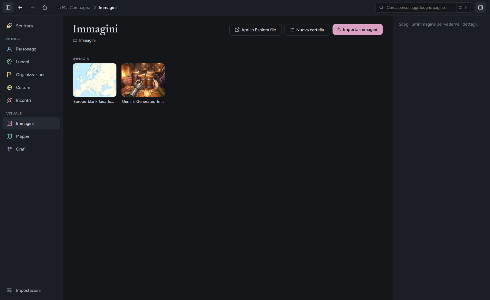

# GM Journal
*Questo è un piccolo progetto personale, una prima versione in italiano; è stato sviluppato con un misto di vibe-coding e coding tradizionale. Si tratta del mio primo software sviluppato in autonomia, non posso quindi assicurarne il funzionamento perfetto, prego chiunque voglia utilizzarlo a segnalare eventuali bug o problematiche. Grazie e buona scrittura.*

Un piccolo programma gratuito per **costruire il mondo e scrivere le campagne** dei giochi di ruolo (D&D e simili).
Tutto in un solo posto, con un aspetto scuro e minimale, e i tuoi dati restano sul tuo computer.



## Cosa sa fare

- **Scrittura** – un editor di testo completo (titoli, elenchi, tabelle, immagini, evidenziatore, correttore ortografico italiano) con capitoli e sottocapitoli.
- **Personaggi, Luoghi, Organizzazioni** – schede con immagini, relazioni e membri.
- **Culture** – popoli, religioni, razze e lingue del tuo mondo, con un editor libero e suggerimenti di titoli (Origine, Società, Valori…).
- **Collegamenti** – scrivi `@` nel testo per collegare pagine, personaggi, luoghi, mappe e grafi; Ctrl+K cerca in tutto.
- **Immagini** – una libreria con cartelle.
- **Mappe** – mappe interattive con pin, anche mappe dentro altre mappe.
- **Grafi** – mappe mentali con nodi e collegamenti.
- **Incontri** – schede dei mostri (importabili da file XML) e calcolo della difficoltà di un combattimento.
- **Backup** – salvi una campagna in un solo file e la ripristini quando vuoi.

## Un giro nel programma

**La Home** – ogni campagna ha la sua cartella. Da qui la apri, ne crei una nuova, la duplichi o la ripristini da un backup.



**Personaggi, Luoghi, Organizzazioni e Culture** – elenchi a tessere con categorie colorate e un'anteprima a destra.



**La scheda completa** – campi, immagini, mappe, relazioni con gli altri elementi e uno spazio di appunti liberi con lo stesso editor di Scrittura.



**Mappe interattive** – scegli un'immagine come sfondo e posa dei pin collegati a luoghi, personaggi e pagine. Un pin può aprire un'altra mappa.



**Grafi** – mappe mentali con nodi colorati e collegamenti con etichette e frecce, per schemi di trama, alleanze e intrighi.



**Immagini** – una libreria con cartelle, da riusare in schede, mappe e testi.



## Come si installa

Guida passo per passo: **[docs/installazione.md](docs/installazione.md)**. In breve:

**Windows (la via più semplice)**
1. Apri la pagina **Releases** di questo repository (a destra, nella pagina principale).
2. Scarica `GMJournal-Setup-….exe` e avvialo. Non servono permessi di amministratore.
   Se Windows mostra «Windows ha protetto il PC», clicca «Ulteriori informazioni» → «Esegui comunque» (il programma non è firmato).
3. In alternativa scarica lo `.zip` «Portable»: lo scompatti dove vuoi e lanci `GMJournal.exe`.

**Linux**: scarica il file `.run` da Releases e avvialo con `sh GMJournal-….run`.

**Dal codice** (serve [Python](https://www.python.org/downloads/) 3.11 o più recente)

```
pip install -r requirements.txt
python main.py
```

Su Windows basta anche un doppio clic su `avvia.bat`.

Le campagne si salvano in `Documenti\GM Journal\`.

## Documentazione

- [Installazione passo per passo](docs/installazione.md).
- [Novità di ogni versione](CHANGELOG.md).
- [Guida dettagliata](docs/guida.md) – struttura del codice, funzioni, scorciatoie.
- [Costruire gli installer](installer/README.md).
- Per provare che tutto funzioni: `python tests/run_all.py`.

## Licenza

Il codice è rilasciato con licenza **MIT** (vedi `LICENSE`): puoi usarlo, copiarlo, modificarlo e ridistribuirlo liberamente.

Il programma usa componenti di altri autori, ciascuno con la sua licenza:

- **PySide6 / Qt** – LGPL 3
- **spylls** – MIT
- **Figtree** e **Newsreader** (font) – SIL Open Font License (testi in `assets/fonts`)
- **Dizionario italiano** (LibreItalia / LibreOffice) – GPL 3 (testo in `assets/dictionaries/it_IT`). Resta un file di dati separato, con la propria licenza.
