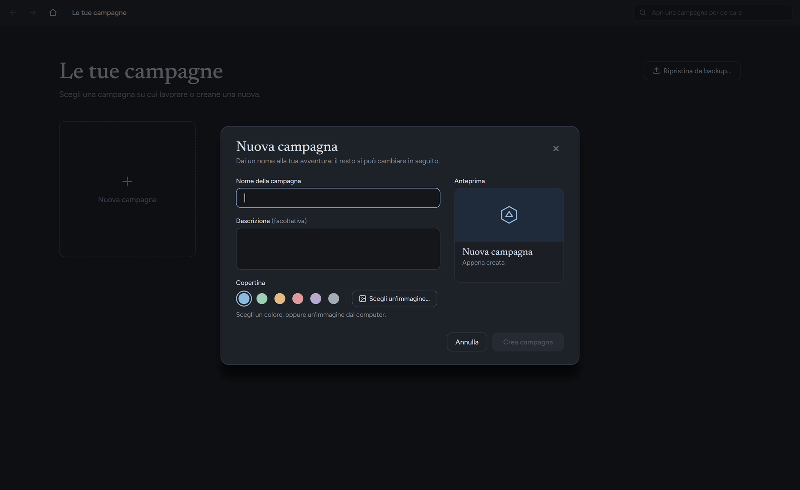

# Installare GM Journal

Scegli il tuo sistema: [Windows](#windows) · [Linux](#linux) · [Dal codice](#dal-codice-per-chi-ha-python)

I file da scaricare si trovano nella pagina **Releases** del repository (nella pagina principale, a destra, sotto «Releases»; clicca sulla versione più recente).
Le tue campagne non vengono mai toccate quando aggiorni o disinstalli il programma.

---

## Windows

**Requisiti:** Windows 10 (versione 1903 o più recente) o Windows 11, a 64 bit. Non serve installare Python né altro.

### Con l'installer (consigliato)

1. Nella pagina Releases scarica il file `GMJournal-Setup-….exe`.
2. Fai doppio clic sul file scaricato.
3. Windows può mostrare la schermata blu **«Windows ha protetto il PC»**. Il programma non è firmato digitalmente (la firma è a pagamento), ma non è pericoloso. Clicca **Ulteriori informazioni**, poi **Esegui comunque**.
4. Segui la procedura guidata: puoi scegliere la cartella e se creare l'icona sul desktop. Non servono i permessi di amministratore.
5. Alla fine lascia la spunta su «Avvia GM Journal» e premi **Fine**.

Dopo l'installazione trovi il programma nel menu Start, alla voce **GM Journal**.

**Disinstallare:** *Impostazioni → App → App installate*, cerca «GM Journal» e scegli *Disinstalla*. Le campagne in `Documenti\GM Journal` restano dove sono.

### Versione portatile (senza installazione)

Utile per una chiavetta USB o per un computer dove non puoi installare programmi.

1. Scarica `GMJournal-Portable-….zip`.
2. Prima di aprirlo: clic destro sul file → **Proprietà** → spunta **Annulla blocco** (se c'è) → **OK**. Evita l'avviso di Windows.
3. Estrai tutto lo zip in una cartella (non farlo partire da dentro lo zip), per esempio sul desktop o sulla chiavetta. La cartella deve essere scrivibile.
4. Apri la cartella e fai doppio clic su `GMJournal.exe`.

Nella versione portatile campagne e backup restano nella stessa cartella (`Campagne\` e `Backup\`). Per disinstallarla basta cancellare la cartella, ma **prima copia fuori le tue campagne**.

---

## Linux

**Requisiti:** una distribuzione recente a 64 bit (x86_64), per esempio Ubuntu 24.04 o più recente, Debian, Fedora, Arch. Il pacchetto è costruito su Ubuntu 24.04 e non funziona su distribuzioni molto più vecchie.

1. Nella pagina Releases scarica il file `GMJournal-….run`.
2. Apri il **Terminale** nella cartella dove l'hai scaricato (di solito `Scaricati` o `Downloads`; nel gestore dei file: clic destro → *Apri nel terminale*).
3. Avvia l'installazione:
   ```
   sh GMJournal-1.0.0-linux-x86_64.run
   ```
   (usa il nome esatto del file che hai scaricato; puoi scriverne l'inizio e premere Tab per completarlo).
4. Il programma si installa solo per il tuo utente (in `~/.local`), senza password di amministratore, e compare nel menu delle applicazioni come **GM Journal**.

Per avviarlo: cerca «GM Journal» nel menu delle applicazioni, oppure scrivi nel terminale `gm-journal`.

**Se non si apre la finestra:** probabilmente manca una libreria di sistema. L'installazione ti dice quale e quale comando usare. La più comune è:

| Distribuzione | Comando |
|---|---|
| Ubuntu / Debian / Mint | `sudo apt install libxcb-cursor0` |
| Fedora | `sudo dnf install xcb-util-cursor` |
| Arch | `sudo pacman -S xcb-util-cursor` |

Se l'installazione si lamenta del comando `xz`, installalo allo stesso modo (pacchetto `xz-utils` su Ubuntu/Debian).

**Disinstallare:**
```
~/.local/opt/GMJournal/uninstall.sh
```
Le campagne non vengono toccate.

---

## Dal codice (per chi ha Python)

Serve [Python](https://www.python.org/downloads/) 3.11 o più recente. Su Windows, durante l'installazione di Python, spunta **«Add python.exe to PATH»**.

1. Scarica il codice: nella pagina principale del repository clicca **Code → Download ZIP** ed estrai lo zip.
2. **Windows:** fai doppio clic su `avvia.bat` (la prima volta installa da solo le librerie che servono).
   **Linux / macOS:** apri il terminale nella cartella ed esegui:
   ```
   pip install -r requirements.txt
   python3 main.py
   ```

---

## Il primo avvio

Al primo avvio la Home è vuota. Clicca **Nuova campagna**, scrivi un nome (la descrizione è facoltativa), scegli un colore o un'immagine di copertina e premi **Crea campagna**. Poi clicca sulla campagna per aprirla.



## Dove sono le mie campagne?

In `Documenti\GM Journal\` (Linux: `~/Documenti/GM Journal/`), una cartella per campagna. Per fare una copia di sicurezza usa **Salva backup…** dal menu «⋯» di una campagna nella Home: crea un solo file `.gmj` che puoi ripristinare con **Ripristina da backup…**.

## Qualcosa non funziona?

Se il programma non parte o si chiude, su Windows controlla il file `%LOCALAPPDATA%\GM Journal\errore.log` (nella versione portatile sta accanto a `GMJournal.exe`) e allegalo quando apri una segnalazione nella sezione **Issues** del repository.
